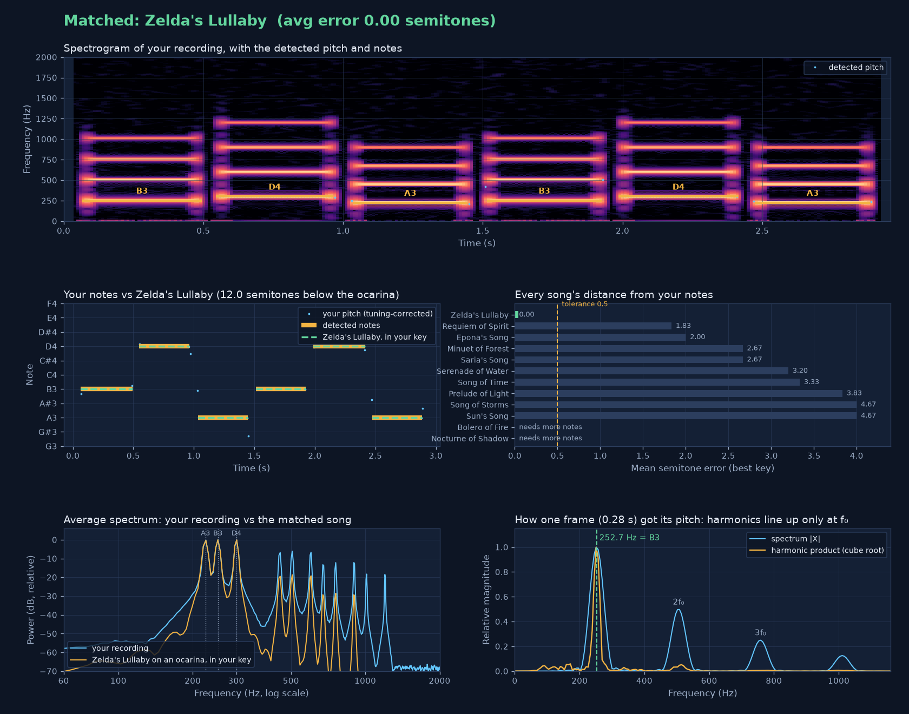

# ocarina-hum-matcher

By Diivanand Ramalingam

Hum, sing or whistle an *Ocarina of Time* song into your microphone. The `ocarina` command names the song, plays it back on an ocarina and draws a report of what it heard. It's the same idea as the Switch 2 remake's microphone feature, built from scratch with an FFT, a harmonic product spectrum and a little linear algebra.



## Quick start

You need [uv](https://docs.astral.sh/uv/) (Python 3.10+ is fetched for you if missing).

```sh
cd ocarina-hum-matcher
uv sync
uv run ocarina listen --plot report.png
```

Hum one of the 12 songs. Recording stops as soon as a song is recognized; the tool then plays it back and saves the report.

```text
Listening for up to 12 s. Hum, sing or whistle a song (Ctrl+C stops).
   2.9s [██████····]  -24 dB    A3  +8¢   notes: B3 D4 A3 B3 D4 A3
Recorded 3.0 s at 48000 Hz.

Detected 6 notes: B3 D4 A3 B3 D4 A3   (tuning +8 cents)

Matched: Zelda's Lullaby  (avg error 0.00 semitones; you sang 12.0 semitones below the ocarina)
```

No microphone handy? Try the bundled recording, or make your own:

```sh
uv run ocarina identify examples/zeldas-lullaby-hum.wav --plot report.png
uv run ocarina synth storms storms.wav && uv run ocarina identify storms.wav --show
```

To install `ocarina` as a command you can run anywhere: `uv tool install .`

## Commands

| Command | What it does |
| --- | --- |
| `ocarina listen` | Records from the mic with a live level and pitch meter. Stops when a song matches (`--full` keeps recording) and plays it back (`--no-play` skips that). Options: `--seconds 12`, `--device N`, `--save rec.wav`, `--plot report.png`, `--show`, `--tolerance 0.5`. |
| `ocarina identify FILE.wav` | The same analysis for a WAV file. Options: `--play`, `--plot`, `--show`, `--tolerance`. |
| `ocarina play SONG` | Plays a song on a synthesized ocarina; `--save out.wav` writes it instead. Fragments work: `storms`, `zelda`, `bolero`. |
| `ocarina songs` | Lists the songs and their notes. |
| `ocarina synth SONG OUT.wav` | Writes a test recording. Options: `--timbre hum` or `ocarina`, `--transpose -10`, `--noise 0.003`. |
| `ocarina devices` | Lists microphones; pass the index to `listen --device`. |
| `ocarina slides` | Opens an interactive talk: 20 minutes of slides that build sound, the DFT, the FFT and the linear algebra behind this tool from scratch (no signal-processing background needed), then a 10-minute terminal demo runbook. It's served from localhost, so the deck's in-browser mic demo works. |

Exit codes: `0` a song matched, `1` no match, `2` an error (bad file, no audio device).

## Tips for humming

- About two notes a second works well. Leave a short gap between repeated notes, such as the A–A in Serenade of Water and Nocturne of Shadow; otherwise they merge into one note.
- Any key is fine, and so is being consistently sharp or flat: the matcher ignores key, and the tuning correction absorbs up to half a semitone of drift.
- Humming, "doo", whistling and a real ocarina all work. Keep background noise low.
- Close but no match? Try `--tolerance 0.75`, and check the report to see which note went astray.

## The report

`--plot report.png` saves it; `--show` opens it in a window. It has five panels:

1. **Spectrogram** of your recording, with the detected pitch (blue dots) and notes (gold). Each note's harmonics show as a stack of evenly spaced lines.
2. **Your notes vs the matched song**, shifted into your key, so a wrong note stands out.
3. **Distance to every song**, the mean semitone error after the best key change, with the tolerance line.
4. **Average spectrum**: your mic input against the matched song played on an ocarina in your key. The peaks line up at the song's notes, and your voice adds harmonics the near-pure ocarina lacks.
5. **One frame's pitch decision**: the spectrum and the harmonic product. Only at the fundamental do the 2f₀ and 3f₀ peaks line up.

## The songs

The ocarina has five notes: D4, F4, A4, B4 and D5.

| Regular songs | Notes | Warp (temple) songs | Notes |
| --- | --- | --- | --- |
| Zelda's Lullaby | B4 D5 A4 B4 D5 A4 | Minuet of Forest | D4 D5 B4 A4 B4 A4 |
| Epona's Song | D5 B4 A4 D5 B4 A4 | Bolero of Fire | F4 D4 F4 D4 A4 F4 A4 F4 |
| Saria's Song | F4 A4 B4 F4 A4 B4 | Serenade of Water | D4 F4 A4 A4 B4 |
| Sun's Song | A4 F4 D5 A4 F4 D5 | Nocturne of Shadow | B4 A4 A4 D4 B4 A4 F4 |
| Song of Time | A4 D4 F4 A4 D4 F4 | Requiem of Spirit | D4 F4 D4 A4 F4 D4 |
| Song of Storms | D4 F4 D5 D4 F4 D5 | Prelude of Light | D5 A4 D5 A4 B4 D5 |

The Scarecrow's Song is left out because each player composes their own.

## How it works

1. **Frames.** The audio is cut into 40 ms frames every 10 ms. Each frame is a vector, 1,764 samples at 44.1 kHz.
2. **Spectrum.** A Hann window tames leakage, then an FFT, zero-padded 4× (7,200 points), gives a bin every 6.1 Hz.
3. **Harmonic product spectrum.** The spectrum is multiplied by copies of itself compressed 2× and 3×. Only the true fundamental sits on a peak in all three, which avoids octave errors. A bin must hold at least 10% of the loudest bin's magnitude, or a whistle (nearly a pure sine) would lock onto a subharmonic.
4. **Peak refinement.** A hill-climb finds the top of the spectral peak, and a parabola through the log magnitudes of three bins locates it to a fraction of a bin. That matters because semitones near 150 Hz are under 9 Hz apart.
5. **Notes.** Hz becomes MIDI with `69 + 12·log2(f/440)`. Your overall tuning comes from the circular mean of the fractional parts, so being 40 cents sharp doesn't split notes. Runs shorter than 80 ms (slides and wobble) are dropped, and a repeated note needs a 30 ms rest.
6. **Matching.** A melody is a vector, and changing key adds a multiple of the all-ones vector. For each song and each window of your notes, the best key shift is the median difference, which minimizes the mean absolute error. The best song wins if its error is at most 0.5 semitones. Songs of the same length are at least 1.5 apart, so by the triangle inequality no window can be within tolerance of two of them. Songs of different lengths can come closer: Requiem is 1.17 from six notes of Bolero. That leaves exactly one ambiguous hum: Bolero with its seventh note sung as F4 instead of A4 (in any key) is exactly 0.5 from both Bolero and Requiem. Ties go to the longer song, so it matches Bolero. A brute-force search over every hum within tolerance of any song finds no other case.

### Cost, in plain words

- **Per frame:** the FFT of 7,200 points takes about N·log₂N ≈ 92 thousand operations. A direct DFT would need N² ≈ 52 million, about 560× more. The harmonic product and peak refinement are a few passes over 1,200 bins.
- **Per recording:** there are 100 frames per second, so work grows in step with length: twice the humming, twice the work. Five seconds is roughly 50 million operations, a few milliseconds in NumPy.
- **Matching:** 12 songs × each window × at most 8 notes is a few thousand operations, so it costs next to nothing.
- **Live mode** re-analyzes everything recorded so far every half second. Over a session that grows with the square of its length, but the 12-second cap keeps each check to a fraction of a second.

## Learn the math

[**The Mathematics of Humming a Song**](docs/ocarina-math-primer.pdf) is a 20-page primer that proves why every step above works. It assumes a first course in linear algebra and no signal processing. Its ten short lessons cover:

1. sampling and pitch
2. complex exponentials
3. the DFT as a change of basis
4. how `fft` lays out its output
5. shifts and circulant matrices
6. leakage and windows
7. the FFT
8. the harmonic product spectrum
9. the circular-mean tuning correction
10. key-invariant matching

Each lesson has definitions, proofs, worked examples, a box pointing at the code that implements it, and two or three exercises. Answers are in an appendix. It pairs with the slide deck (`ocarina slides`).

The LaTeX source is in `docs/primer/`. Rebuild it with:

```sh
cd docs/primer && latexmk -pdf -outdir=build primer.tex && cp build/primer.pdf ../ocarina-math-primer.pdf
```

## Python API

```python
from ocarina_hum_matcher import analyze, load_wav, rank_songs

signal, rate = load_wav("hum.wav")
analysis = analyze(signal, rate)
print(analysis.midi_notes)  # [59, 62, 57, 59, 62, 57]
best = rank_songs(analysis.midi_notes)[0]
print(best.name, best.error, best.transpose)  # Zelda's Lullaby 0.0 -12.0
```

`match_song(notes, tolerance, songbook)` accepts your own songbook, for example one that includes your Scarecrow's Song.

## Development

```sh
uv run pytest        # 30 tests: two per song, plus the CLI with a simulated microphone
uv run mypy          # strict type checking
uv run ruff check && uv run ruff format --check
```

Each song's positive test hums it in another key, 40 cents sharp, and expects a match. Its negative test hums the same notes backwards and expects no match.

## Troubleshooting

- **"PortAudio library not found"** (Linux): `sudo apt install libportaudio2`. The macOS and Windows wheels bundle it.
- **macOS records silence:** allow your terminal app in System Settings › Privacy & Security › Microphone.
- **Wrong microphone:** run `ocarina devices`, then `ocarina listen --device 2`.
- **Not a WAV file:** `identify` reads WAV only. Convert other formats with `ffmpeg -i memo.m4a memo.wav`.
- **`--show` opens no window:** your matplotlib backend has no GUI. Use `--plot report.png` instead.

## Project layout

```text
ocarina-hum-matcher/
├── pyproject.toml           # uv project, `ocarina` entry point
├── uv.lock
├── src/ocarina_hum_matcher/
│   ├── songs.py             # scale, the 12 songs, note names
│   ├── recognizer.py        # pitch tracking, note segmentation, matching
│   ├── synth.py             # ocarina and hum synthesis, WAV writing
│   ├── audio.py             # microphone and speakers (sounddevice / PortAudio)
│   ├── plot.py              # the five-panel report (matplotlib)
│   ├── cli.py               # the `ocarina` command
│   └── slides/index.html    # the interactive slide deck
├── tests/
│   ├── test_songs.py        # 24 tests, two per song
│   └── test_cli.py          # commands, including `listen` with a fake mic
├── examples/zeldas-lullaby-hum.wav
└── docs/
    ├── example-report.png
    ├── ocarina-math-primer.pdf   # the math primer
    └── primer/primer.tex         # its LaTeX source
```

## License

[MIT](LICENCE.md) © 2026 Diivanand Ramalingam. You're free to use, copy, modify and redistribute this project, including the slides and the math primer, as long as you credit Diivanand Ramalingam and keep the copyright and license notice.

This is a fan project, not affiliated with or endorsed by Nintendo.
